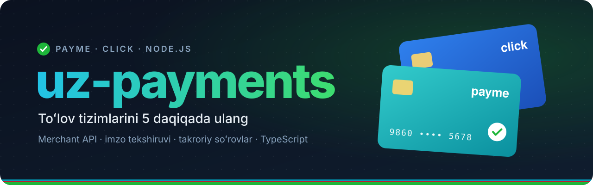

<div align="center">



<br/>

[](https://www.npmjs.com/package/uz-payments)
[](https://github.com/Sheyxzad999/uz-payments/actions)
[](LICENSE)


**Payme va Click toʻlovlarini Node.js loyihangizga ulash — protokol tafsilotlarisiz.**
<br/>Siz faqat “buyurtma bormi?” va “toʻlandi” deb javob berasiz, qolganini kutubxona qiladi.

</div>

---

## 🤔 Muammo

Payme yoki Click'ni har ulaganda bir xil ishlar qaytadan yoziladi:

- Payme JSON-RPC metodlari, tranzaksiya holatlari, 12 soatlik timeout, xato kodlari (`-31008`, `-31050`...)
- Click `md5` imzosini tekshirish, Prepare/Complete, bekor qilingan toʻlovlar
- Takroriy soʻrovlar kelganda ikki marta pul yechilib qolmasligi

**uz-payments** bularning hammasini oʻz ichiga oladi. Sizga bitta funksiya qoladi: buyurtmani tekshirish.

## ✨ Imkoniyatlar

| | Payme | Click |
|---|:---:|:---:|
| Toʻlov sahifasiga havola | ✅ | ✅ |
| Merchant API / SHOP API handler | ✅ | ✅ |
| Avtorizatsiya / imzo tekshiruvi | ✅ Basic auth | ✅ md5 + timing-safe |
| Takroriy soʻrovlarga (idempotent) bir xil javob | ✅ | ✅ |
| Bekor qilish va pulni qaytarish | ✅ | ✅ |
| Timeout (12 soat) | ✅ | — |
| `GetStatement` (hisobot) | ✅ | — |
| Xato xabarlari uz / ru / en | ✅ | ✅ |

Framework'dan mustaqil: **Express, Fastify, Next.js, Hono, NestJS** — hammasida ishlaydi.

## 📦 Oʻrnatish

```bash
npm i uz-payments
```

## 🚀 Payme

### 1. Toʻlov havolasi

```js
import { paymeCheckoutUrl } from 'uz-payments';

const url = paymeCheckoutUrl({
  merchantId: process.env.PAYME_MERCHANT_ID,
  amount: 15000,                 // soʻmda — tiyinga avtomatik oʻgiriladi
  account: { order_id: 42 },
  returnUrl: 'https://shop.uz/orders/42',
  lang: 'uz',
});
// https://checkout.paycom.uz/bT0uLi4=
```

### 2. Merchant API endpoint

```js
import express from 'express';
import { createPaymeHandler, PaymeError, PaymeCode } from 'uz-payments';

const payme = createPaymeHandler({
  key: process.env.PAYME_KEY,
  storage: paymeStorage,                       // pastda qarang 👇

  async checkOrder({ account, amount }) {      // amount — tiyinda
    const order = await db.orders.find(account.order_id);
    if (!order) throw new PaymeError(PaymeCode.ORDER_NOT_FOUND, 'order_id');
    if (order.amount * 100 !== amount) throw new PaymeError(PaymeCode.INVALID_AMOUNT);
  },
  async onPerform(tx) {
    await db.orders.markPaid(tx.account.order_id);   // ✅ pul tushdi
  },
  async onCancel(tx) {
    await db.orders.markCancelled(tx.account.order_id);
  },
});

app.post('/payme', express.json(), async (req, res) => {
  const r = await payme({ headers: req.headers, body: req.body });
  res.status(r.status).json(r.body);
});
```

### Storage

Payme tranzaksiyalarni saqlashni talab qiladi. 5 ta oddiy metod yozasiz:

```ts
interface PaymeStorage {
  find(id): Promise<Transaction | null>;
  create(tx): Promise<void>;
  update(id, patch): Promise<void>;
  list?(from, to): Promise<Transaction[]>;               // GetStatement uchun
  findActiveByAccount?(account): Promise<Transaction | null>; // bir buyurtmaga 2 ta toʻlovni bloklash
}
```

- 🧪 Test va demo uchun: `memoryStorage()`
- 🐘 PostgreSQL uchun tayyor misol: [`examples/postgres-storage.js`](examples/postgres-storage.js)

## 🚀 Click

```js
import { createClickHandler, clickPaymentUrl, ClickError, ClickCode } from 'uz-payments';

const url = clickPaymentUrl({
  serviceId: process.env.CLICK_SERVICE_ID,
  merchantId: process.env.CLICK_MERCHANT_ID,
  amount: 15000,
  transactionParam: 42,          // buyurtma ID
  returnUrl: 'https://shop.uz/orders/42',
});

const click = createClickHandler({
  serviceId: process.env.CLICK_SERVICE_ID,
  secretKey: process.env.CLICK_SECRET_KEY,

  async prepare({ orderId, amount }) {
    const order = await db.orders.find(orderId);
    if (!order) throw new ClickError(ClickCode.ORDER_NOT_FOUND);
    if (order.amount !== amount) throw new ClickError(ClickCode.INVALID_AMOUNT);
    if (order.paid) throw new ClickError(ClickCode.ALREADY_PAID);
    return order.id;             // merchant_prepare_id
  },
  async complete({ orderId }) {
    const order = await db.orders.find(orderId);
    if (order.paid) throw new ClickError(ClickCode.ALREADY_PAID);
    await db.orders.markPaid(orderId);   // ✅ pul tushdi
    return order.id;             // merchant_confirm_id
  },
  async cancel({ orderId }) {
    await db.orders.markCancelled(orderId);
  },
});

// Click'ning Prepare va Complete URL'lari ikkalasi ham shu endpoint'ga
app.post('/click', express.urlencoded({ extended: false }), async (req, res) => {
  const r = await click(req.body);
  res.status(r.status).json(r.body);
});
```

## ▲ Next.js

```js
// app/api/payme/route.js
export async function POST(req) {
  const r = await payme({
    headers: { authorization: req.headers.get('authorization') ?? undefined },
    body: await req.text(),
  });
  return Response.json(r.body, { status: r.status });
}
```

Toʻliq misollar: [`examples/`](examples)

## 🧪 Test qilish

Ikkala tizimning ham test muhiti bor:

- **Payme:** [test.paycom.uz](https://test.paycom.uz) — `paymeCheckoutUrl({ ..., test: true })` va test kaliti bilan
- **Click:** kabinetdagi test rejimi

> ⚠️ **v0.x** — kutubxona yangi. Productionga chiqarishdan oldin albatta toʻlov tizimining test muhitida (sandbox) toʻliq tekshiring.

## 🗺 Reja

- [x] Payme Merchant API
- [x] Click SHOP API
- [ ] Uzum Bank
- [ ] Click Merchant API (karta tokenlari)
- [ ] Payme Subscribe API (karta saqlash)
- [ ] Prisma / Drizzle storage adapterlari

## 🔗 Aloqador

- [**uzkit**](https://github.com/Sheyxzad999/uzkit) — telefon, lotin ↔ kirill, soʻm formati, sonni soʻz bilan yozish

## 🤝 Hissa qoʻshish

Issue va Pull Request'lar xush kelibsiz! Ayniqsa Uzum Bank integratsiyasi boʻyicha.

```bash
git clone https://github.com/Sheyxzad999/uz-payments.git
cd uz-payments
npm test
```

## 📄 Litsenziya

[MIT](LICENSE) © [Shaxzod](https://sheyxzad.uz)

<div align="center">
<sub>🇺🇿 Oʻzbekistonda ❤️ bilan yaratildi · Payme va Click — tegishli kompaniyalarning savdo belgilari, bu loyiha ular bilan rasmiy bogʻliq emas</sub>
</div>
